

  <a href="https://portfolio-guilherme-lima.vercel.app/">
    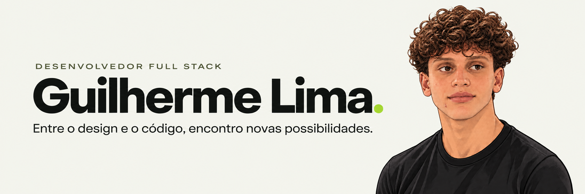
  </a>

## Sobre mim

Sou **Guilherme Lima**, desenvolvedor de Londrina, Paraná. Gosto de transformar ideias em experiências digitais claras e funcionais, conectando design e código.

Trabalho com a criação de sites na **GM Web Studio** e desenvolvo projetos para colocar novos conhecimentos em prática. Atualmente, aprofundo meus estudos em desenvolvimento Full Stack, APIs e organização de dados.

### Tecnologias

  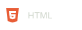
  
  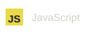
  
  
  

## Projetos em destaque

<a href="https://github.com/20guix09/mirian">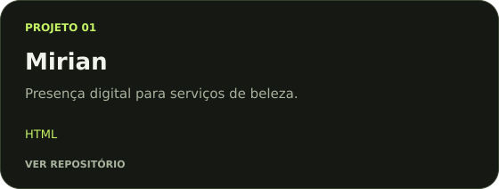</a>

<a href="https://github.com/20guix09/portfolio_Guilherme_Lima">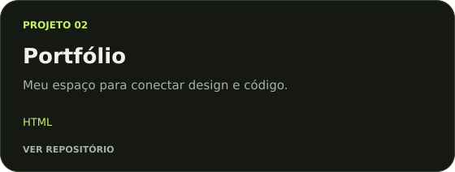</a>

<a href="https://github.com/20guix09/Madureira-Taekwondo">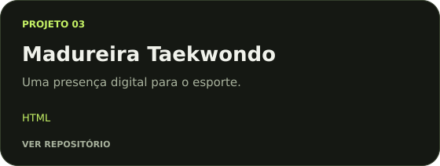</a>

[Explorar todos os repositórios](https://github.com/20guix09?tab=repositories)

## Em constante construção

  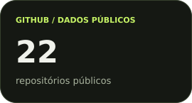
  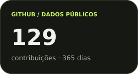
  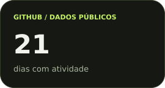

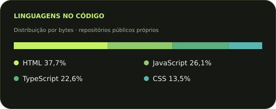

## Do primeiro commit à próxima ideia

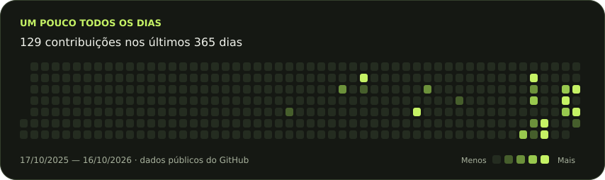

Dados públicos atualizados diariamente. Linguagens calculadas por bytes de código, sem forks.

---

  
  
  

